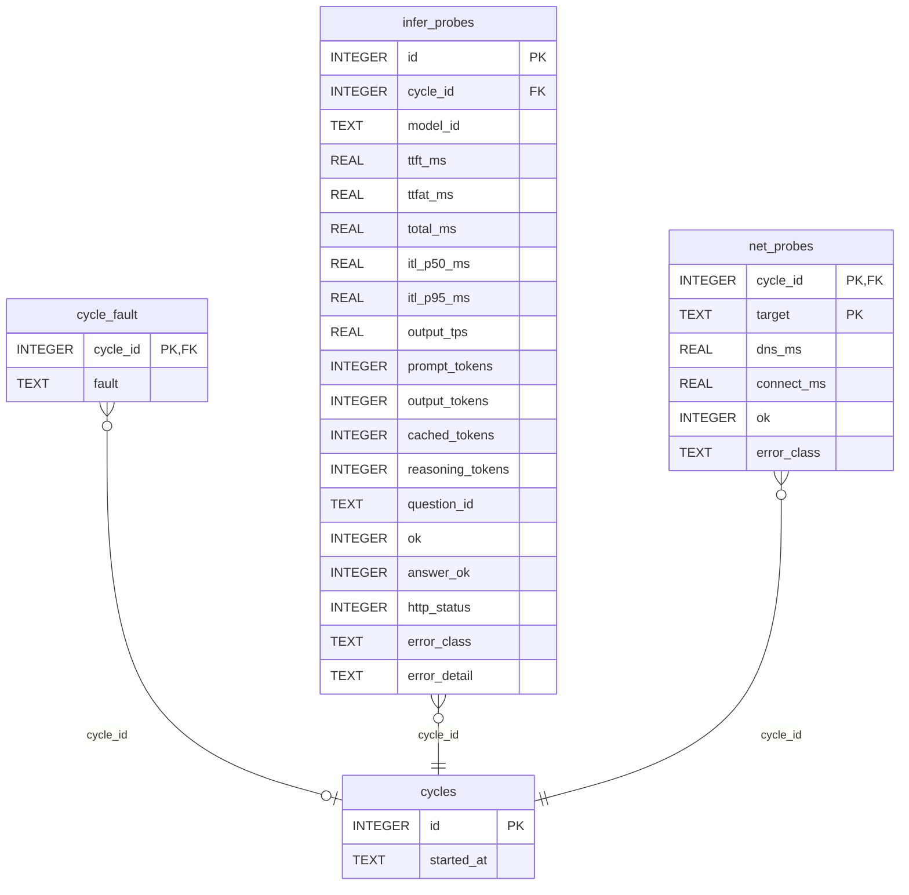

<!-- Generated by github.com/trick77/ship/kit/schemadoc, do not edit. Regenerate: SCHEMADOC_UPDATE=1 go test ./... -run TestSchemaDoc -->

# Database schema

4 tables; the diagram is at the end. Go types are the `model.go` structs whose rows they hold.

## cycle_fault

| Column | Type | Null | Default | PK |
| --- | --- | --- | --- | --- |
| `cycle_id` | INTEGER | yes |  | 1 |
| `fault` | TEXT | no |  |  |

Foreign keys:

- `cycle_id` → `cycles` (`id`), on delete CASCADE

## cycles

| Column | Type | Null | Default | PK |
| --- | --- | --- | --- | --- |
| `id` | INTEGER | yes |  | 1 |
| `started_at` | TEXT | no |  |  |

Indexes:

- `idx_cycles_started_at` (`started_at`)

## infer_probes

Go types:

- `samples.Failure` (internal/samples): Failure is one failed inference call, as the errors block serves it.
- `samples.Sample` (internal/samples): Sample is one raw row, as served publicly.

| Column | Type | Null | Default | PK |
| --- | --- | --- | --- | --- |
| `id` | INTEGER | yes |  | 1 |
| `cycle_id` | INTEGER | no |  |  |
| `model_id` | TEXT | no |  |  |
| `ttft_ms` | REAL | yes |  |  |
| `ttfat_ms` | REAL | yes |  |  |
| `total_ms` | REAL | yes |  |  |
| `itl_p50_ms` | REAL | yes |  |  |
| `itl_p95_ms` | REAL | yes |  |  |
| `output_tps` | REAL | yes |  |  |
| `prompt_tokens` | INTEGER | yes |  |  |
| `output_tokens` | INTEGER | yes |  |  |
| `cached_tokens` | INTEGER | yes |  |  |
| `reasoning_tokens` | INTEGER | yes |  |  |
| `question_id` | TEXT | yes |  |  |
| `ok` | INTEGER | no |  |  |
| `answer_ok` | INTEGER | yes |  |  |
| `http_status` | INTEGER | yes |  |  |
| `error_class` | TEXT | yes |  |  |
| `error_detail` | TEXT | yes |  |  |

Foreign keys:

- `cycle_id` → `cycles` (`id`), on delete CASCADE

Indexes:

- `idx_infer_probes_cycle` (`cycle_id`)
- `idx_infer_probes_model` (`model_id`, `cycle_id`)

## net_probes

| Column | Type | Null | Default | PK |
| --- | --- | --- | --- | --- |
| `cycle_id` | INTEGER | no |  | 1 |
| `target` | TEXT | no |  | 2 |
| `dns_ms` | REAL | yes |  |  |
| `connect_ms` | REAL | yes |  |  |
| `ok` | INTEGER | no |  |  |
| `error_class` | TEXT | yes |  |  |

Foreign keys:

- `cycle_id` → `cycles` (`id`), on delete CASCADE

## Types not stored as rows

### samples.ModelSummary

In `internal/samples`. ModelSummary is one model's state over a window.

| Field | Type | Doc |
| --- | --- | --- |
| `ModelID` | `string` |  |
| `TTFT` | `Stats` |  |
| `ITL` | `Stats` |  |
| `TPS` | `Stats` | TPS is the median gross throughput. It leads the throughput reading |
| `Attempts` | `int` | Availability counts attempts on ATTRIBUTABLE cycles, successes and |
| `Succeeded` | `int` |  |
| `Available` | `float64` |  |
| `Censored` | `int` | Censored is how many of those attempts were cut off by our own timeout |
| `Answered` | `int` | Correctness is the canary: a silent reroute to a smaller model shows up |
| `Correct` | `int` |  |
| `CorrectPct` | `*float64` |  |
| `MaxReasoningTokens` | `int` | MaxReasoningTokens must stay 0. Non-zero means thinking came back on and |
| `MaxCachedTokens` | `int` | MaxCachedTokens must stay near 0, or the system prompt went missing and |

### samples.NetSummary

In `internal/samples`. NetSummary is the network layer over a window.

| Field | Type | Doc |
| --- | --- | --- |
| `Target` | `string` |  |
| `Connect` | `Stats` |  |
| `Attempts` | `int` |  |
| `Succeeded` | `int` |  |
| `Available` | `float64` |  |

### samples.Point

In `internal/samples`. Point is one bucket of a series.

| Field | Type | Doc |
| --- | --- | --- |
| `T` | `int64` | T is the bucket's start, as Unix seconds. |
| `N` | `int` | N is the successful samples the percentiles were computed from. |
| `Censored` | `int` | Censored is how many samples in this bucket our own timeout ladder cut |
| `P50` | `*float64` | Values are nil when the bucket produced no percentile at all. A null |
| `P95` | `*float64` |  |

### samples.Summary

In `internal/samples`. Summary is the whole dashboard state for one window.

| Field | Type | Doc |
| --- | --- | --- |
| `Window` | `string` |  |
| `Cycles` | `int` |  |
| `Models` | `[]ModelSummary` |  |
| `Net` | `[]NetSummary` |  |
| `Recent` | `[]RecentCycle` | Recent is NOT window-scoped — see RecentCycle for why. It rides along in |
| `GeneratedAt` | `time.Time` |  |

## Diagram

